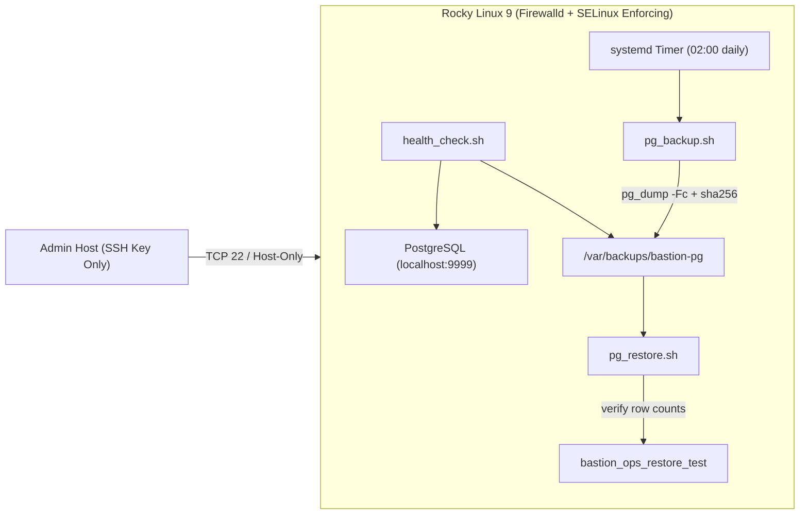

# bastion-pg-ops

CLI-only homelab setup for running a hardened, air-gapped PostgreSQL server on Rocky Linux 9 (RHEL 9 compatible), with Bash scripts for automated backups, restore verification, and host health checks.

## Architecture



## Repository Layout

```text
bastion-pg-ops/
├── configs/
│   └── 99-bastion-hardening.conf    # sshd drop-in (key-only, no root login)
├── docs/
│   ├── hardening.md                 # VM network, SSH, firewalld, SELinux, air-gapped notes
│   ├── postgresql.md                # PostgreSQL port 9999 setup and psql checks
│   ├── backup.md                    # backup directories, manual run, systemd timer
│   ├── restore.md                   # restore drill and verification steps
│   └── monitoring.md                # health check usage and failure scenarios
├── scripts/
│   ├── harden_server.sh             # SSH, firewalld, SELinux Enforcing (dry-run by default)
│   ├── setup_postgres.sh            # install/init PostgreSQL on localhost:9999
│   ├── pg_backup.sh                 # compressed dump, sha256 checksum, logging, retention
│   ├── pg_restore.sh                # checksum verify, restore to test DB, row-count check
│   └── health_check.sh              # CPU, RAM, disk, PG readiness, backup age, SELinux
├── sql/
│   ├── init.sql                     # ops schema (assets, maintenance_logs, audit_events)
│   └── seed.sql                     # sample data for query and restore tests
└── systemd/
    ├── bastion-pg-backup.service
    └── bastion-pg-backup.timer
```

## Quick Start (Rocky Linux 9 / RHEL 9)

1. **Harden the host** (after copying your SSH public key to `~/.ssh/authorized_keys`):
   ```bash
   sudo ./scripts/harden_server.sh
   sudo ./scripts/harden_server.sh --apply
   ```

2. **Install and configure PostgreSQL on port `9999`** (binds to `localhost` only, adds `postgresql_port_t` SELinux rule):
   ```bash
   sudo ./scripts/setup_postgres.sh --apply
   pg_isready -h localhost -p 9999
   ```

3. **Create the database and load schema/seed data**:
   ```bash
   sudo -u postgres psql -p 9999 -c "CREATE ROLE ops_user WITH LOGIN PASSWORD 'change_me';"
   sudo -u postgres psql -p 9999 -c "CREATE DATABASE bastion_ops OWNER ops_user;"
   sudo -u postgres psql -p 9999 -d bastion_ops -f sql/init.sql
   sudo -u postgres psql -p 9999 -d bastion_ops -f sql/seed.sql
   ```

4. **Run a backup and verify restore**:
   ```bash
   sudo mkdir -p /var/backups/bastion-pg /var/log/bastion-pg
   sudo chown -R postgres:postgres /var/backups/bastion-pg /var/log/bastion-pg

   sudo -u postgres ./scripts/pg_backup.sh
   LATEST="$(ls -t /var/backups/bastion-pg/bastion_ops_*.dump | head -n 1)"
   sudo -u postgres ./scripts/pg_restore.sh "${LATEST}"
   ```

5. **Run the health check**:
   ```bash
   ./scripts/health_check.sh
   ```
   Exit codes: `0` (OK), `1` (WARN), `2` (CRIT).

## Security Notes
- SSH password authentication and root login are disabled via `/etc/ssh/sshd_config.d/99-bastion-hardening.conf`.
- `firewalld` allows `ssh` only on the `public` zone; PostgreSQL (`9999/tcp`) is kept on `localhost`.
- `SELinux` stays in `Enforcing` mode throughout; custom port `9999` is explicitly labeled with `semanage port`.
- Once packages are installed, the NAT adapter can be disabled to verify offline/air-gapped operation over the Host-Only interface.

## Documentation
- [Server Hardening](docs/hardening.md)
- [PostgreSQL Setup](docs/postgresql.md)
- [Backup & Retention](docs/backup.md)
- [Restore Verification](docs/restore.md)
- [Monitoring & Failure Scenarios](docs/monitoring.md)
