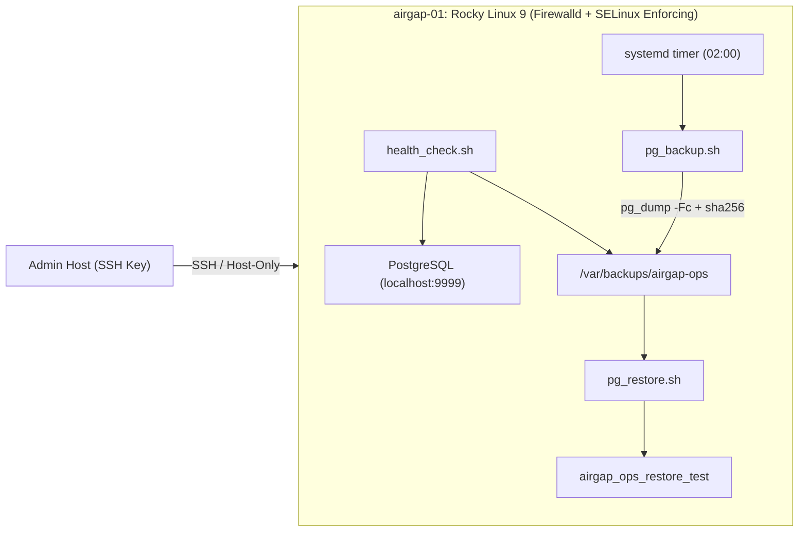

# AirgapOps — Linux Hardening & Backup Suite

Linux server hardening and automated backup suite for running an air-gapped PostgreSQL instance on Rocky Linux 9 (RHEL 9 compatible). Everything runs from the terminal using Bash scripts and `systemd` units: SSH/firewall/SELinux hardening, PostgreSQL setup on port `9999`, scheduled backups with SHA-256 checksums, restore verification, and health checks.

## Architecture



## Layout

```text
airgap-ops/
├── configs/
│   └── 99-airgap-hardening.conf     # sshd drop-in (key-only, no root login)
├── docs/
│   ├── hardening.md                 # network, sshd, firewalld, SELinux, air-gapped setup
│   ├── postgresql.md                # PostgreSQL setup on port 9999
│   ├── backup.md                    # pg_backup.sh + systemd timer
│   ├── restore.md                   # restore test procedure
│   └── monitoring.md                # health check and failure tests
├── scripts/
│   ├── harden_server.sh             # sshd, firewalld, SELinux check/apply
│   ├── setup_postgres.sh            # PostgreSQL install, SELinux port 9999, pg_hba.conf
│   ├── pg_backup.sh                 # compressed dump, sha256, logging, retention
│   ├── pg_restore.sh                # checksum check, restore to test DB, row counts
│   └── health_check.sh              # CPU, RAM, disk, PG connections, backup age, SELinux
├── sql/
│   ├── init.sql                     # ops schema and tables
│   └── seed.sql                     # sample rows for testing
└── systemd/
    ├── airgap-backup.service
    └── airgap-backup.timer
```

## Setup on Rocky Linux 9 / RHEL 9

### 1. Harden the server
Copy your SSH public key to `~/.ssh/authorized_keys` first, verify key login, then apply:

```bash
chmod +x scripts/*.sh
sudo ./scripts/harden_server.sh
sudo ./scripts/harden_server.sh --apply
```

### 2. Install and configure PostgreSQL (port 9999)
Binds PostgreSQL to `localhost:9999`, adds `9999/tcp` to SELinux `postgresql_port_t`, and sets `scram-sha-256` on loopback TCP:

```bash
sudo ./scripts/setup_postgres.sh --apply
pg_isready -h localhost -p 9999
```

### 3. Initialize database and schema
```bash
sudo -u postgres psql -p 9999 -c "CREATE ROLE ops_user WITH LOGIN PASSWORD 'change_me';"
sudo -u postgres psql -p 9999 -c "CREATE DATABASE airgap_ops OWNER ops_user;"
sudo -u postgres psql -p 9999 -d airgap_ops -v ON_ERROR_STOP=1 < sql/init.sql
sudo -u postgres psql -p 9999 -d airgap_ops -v ON_ERROR_STOP=1 < sql/seed.sql
```

### 4. Configure backups and test restore
```bash
sudo install -m 755 scripts/pg_backup.sh scripts/pg_restore.sh /usr/local/bin/
sudo mkdir -p /var/backups/airgap-ops /var/log/airgap-ops
sudo chown -R postgres:postgres /var/backups/airgap-ops /var/log/airgap-ops
sudo chmod 750 /var/backups/airgap-ops /var/log/airgap-ops

sudo -u postgres /usr/local/bin/pg_backup.sh
LATEST="$(sudo find /var/backups/airgap-ops -maxdepth 1 -name 'airgap_ops_*.dump' | sort | tail -n 1)"
sudo -u postgres /usr/local/bin/pg_restore.sh "${LATEST}"
```

To enable daily scheduled backups at 02:00:
```bash
sudo cp systemd/airgap-backup.service systemd/airgap-backup.timer /etc/systemd/system/
sudo systemctl daemon-reload
sudo systemctl enable --now airgap-backup.timer
```

### 5. Run health check
```bash
sudo ./scripts/health_check.sh
```
Exit codes: `0` (OK), `1` (WARN), `2` (CRIT).

## Security & Air-gapped Operation
- Password authentication and root SSH login are disabled (`/etc/ssh/sshd_config.d/99-airgap-hardening.conf`).
- `firewalld` exposes only `ssh` on the `public` zone; PostgreSQL listens strictly on `localhost:9999`.
- SELinux remains in `Enforcing` mode (`getenforce`).
- After installing `postgresql-server` and `policycoreutils-python-utils`, disable the VM's NAT adapter to run offline over the Host-Only network (`192.168.56.0/24`).

## Docs
- [docs/hardening.md](docs/hardening.md)
- [docs/postgresql.md](docs/postgresql.md)
- [docs/backup.md](docs/backup.md)
- [docs/restore.md](docs/restore.md)
- [docs/monitoring.md](docs/monitoring.md)
